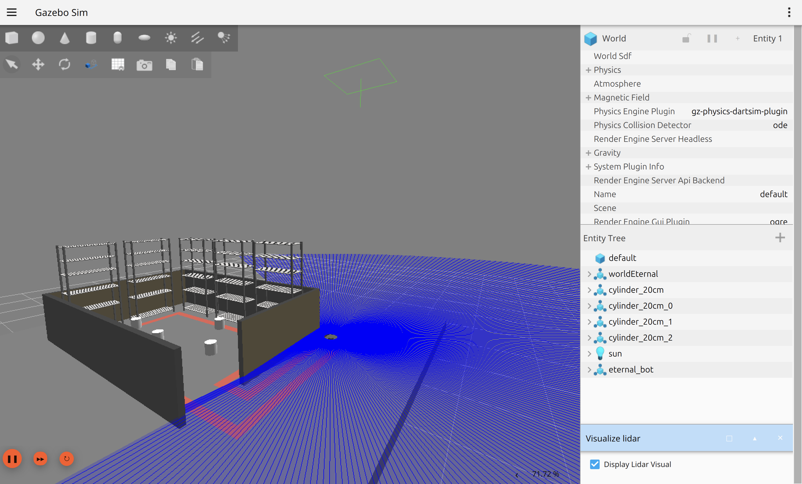
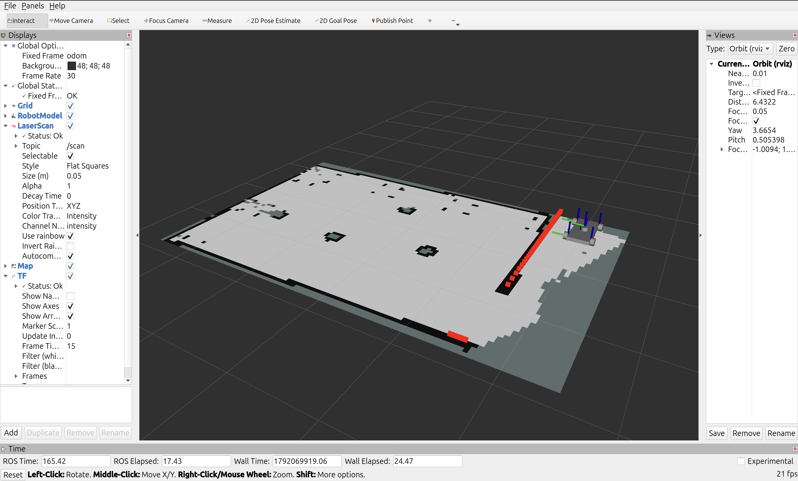
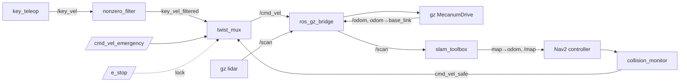
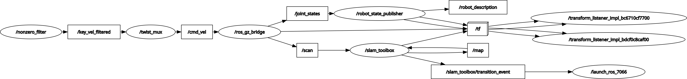

# eternal_bot_26

A 4-wheel **mecanum** robot simulated in Gazebo, driven by keyboard or by Nav2 on a SLAM map.

 

| Gazebo (`arena_obs`) | Nav2 ready RViz (already SLAMed) |
|---|---|
|  |  |

## Highlights
- **Mecanum without rollers.** Each wheel is a sphere collision with anisotropic friction: μ=1 along a ±45° `fdir1`, μ=0 across it. The gz MecanumDrive plugin drives the wheel joints.
- **Safe command routing.** twist_mux ranks emergency stop over keyboard teleop over Nav2, and a `/e_stop` lock blocks motion.
- **SLAM.** slam_toolbox maps the arena; the saved pose graph is reused for localization.
- **Nav2.** Holonomic planning on the map, with a collision monitor in front of the mux.

## Architecture


Live node graph:



## Quickstart
Requires Ubuntu 24.04, ROS 2 Jazzy and Gazebo Harmonic, plus:
```bash
sudo apt install ros-jazzy-ros-gz ros-jazzy-slam-toolbox ros-jazzy-nav2-bringup \
  ros-jazzy-twist-mux ros-jazzy-key-teleop ros-jazzy-xacro
```
Build, then run each step in its own terminal from the repo root:
```bash
make build
make sim WORLD=arena_obs   # Gazebo + bridge + twist_mux
make slam                  # slam_toolbox (localizes on maps/obs_map2)
make nav                   # Nav2; send goals with RViz "2D Goal Pose"
make rviz
make teleop                # optional keyboard drive
```
`make help` lists every target, including `estop`, `estop-release` and `stop`.

### Render engine
The sim uses Gazebo's `ogre2` renderer by default. It is a launch argument that can be changed at runtime, and it applies to both the Gazebo GUI/server and the lidar sensor:
```bash
make sim RENDER=ogre                                                  # e.g. in a VM without proper GPU support
ros2 launch eternal_bot_description gazebo.launch.py render_engine:=ogre
```
The same `render_engine:=` argument works for `gazebo_min.launch.py`.

## Documentation
[`documentation/`](documentation/README.md) is the build log: debugging history, design decisions and chapters on drive, lidar, SLAM and Nav2. Read it before changing physics or the drive.

## License
[MIT](LICENSE)
